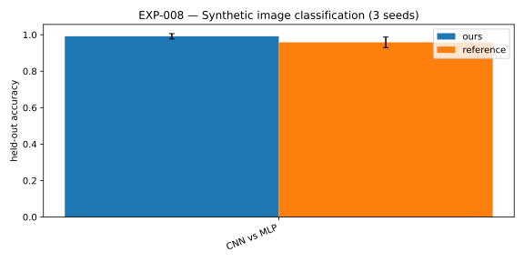

# Deep Learning From Scratch — AIR-004

**Status:** educational implementation locally verified; scientific audit and hosted CI pending.

NumPy neural network layers, manual backpropagation, SGD, momentum, Adam, dropout, L2 and valid 2D convolution. PyTorch is used only as a reference in tests and experiments. Complements [AIR-001](https://github.com/MarkRizam/machine-learning-from-scratch), [AIR-002](https://github.com/MarkRizam/mathematics-for-ai), [AIR-003](https://github.com/MarkRizam/statistics-for-ai) and [RizamLearning](https://github.com/MarkRizam/RizamLearning).

## Quick start
Use Python 3.13 in a virtual environment; install CPU PyTorch first. PowerShell: `$env:OPENBLAS_NUM_THREADS='1'`; `$env:OMP_NUM_THREADS='1'`. Bash: `export OPENBLAS_NUM_THREADS=1 OMP_NUM_THREADS=1`.

```sh
python -m pip install torch==2.10.0 --index-url https://download.pytorch.org/whl/cpu
python -m pip install numpy==2.3.5 -e ".[research]"
python -m pytest -q
python scripts/verify_committed_results.py
python -m dl_from_scratch.experiments
python scripts/notebooks.py
```

## Evidence
8 experiments, 21 configurations, 63 per-seed records, 30 local tests and 8 executed notebooks. All synthetic; no paid APIs or GPU needed. See [protocol](research/protocol.md), [report](research/report.md), [raw records](results/benchmarks.json), [limitations](research/limitations.md).



MIT for original code. Dependencies retain their licenses. Not a peer-reviewed study or production framework. See [LICENSE](LICENSE) and [CONTRIBUTING.md](CONTRIBUTING.md).
